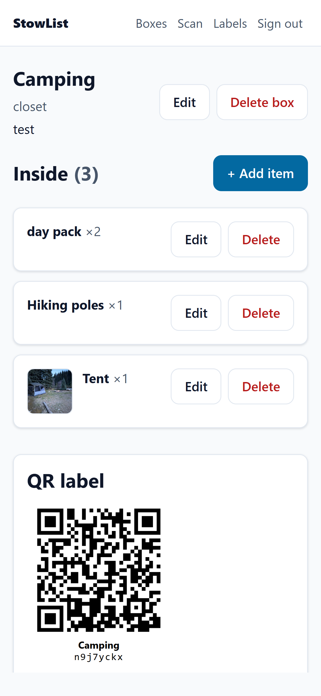
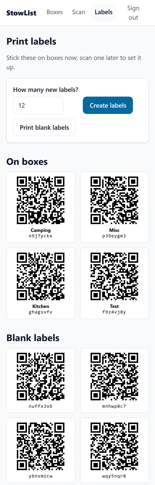

# StowList

**Stick a QR label on any box, scan it with your phone, and see what's inside.**

StowList is a mobile-first web app for keeping track of what's stored in boxes, bins and
shelves. Each box gets a printable QR label; scanning it with a phone camera opens that
box's contents, ready to add, edit or remove items. You can also search every box at once
("where's the HDMI cable?").

**Live app:** https://stowlist-kadecampbell.netlify.app

<!-- Add screenshots to docs/screenshots/ with these names (or change the paths below). -->
<p align="center">
  
  &nbsp;
  
  &nbsp;
  
</p>

## Features

- **QR labels for every box.** A label is created automatically with each box, or print a
  sheet of blank labels first and set up each box the first time you scan it.
- **Scan to open.** Any phone camera works: the QR code is a link to the box. There's also an
  in-app scanner that recognises other products' barcodes and QR codes, so existing packaging
  can be used as a label.
- **Items with photos.** Add, edit and delete items with quantities, descriptions and a photo
  taken straight from the phone camera.
- **Search across every box** by item name or description.
- **Printable label sheets** laid out four across for sticker paper.
- **Accounts** with email and password, including password reset by email.
- **Private by design.** Each user can only ever see their own boxes, items, labels and photos.

## Built with

| | |
|---|---|
| Front end | React 18, React Router, Vite |
| Back end | Supabase: Postgres, Auth, Storage |
| QR codes | `qrcode.react` (generating), `qr-scanner` (in-app camera scanning) |
| Hosting | Netlify |

No custom server: the browser talks to Supabase directly, and the database itself
enforces who can see what.

## How it works

**Security lives in the database.** Every table has a `user_id` column and Postgres
row-level security policies (`user_id = auth.uid()`), so a query can only ever return the
signed-in user's rows, even if the front end had a bug. Item photos are in a private storage
bucket, filed under each user's own folder, with matching policies, and are shown through
short-lived signed URLs.

**Labels are just links.** Each QR code holds a URL like `/q/ab3k9xqp`. Opening it looks the
code up and either opens the box, offers to set up a new box for a blank label, or shows
"Label not found". Signed-out visitors are sent to sign in and then returned to the box they
scanned.

**Mobile-first and fast.** Photos are resized in the browser (to about 1200 px) before upload,
so a 4 MB phone photo uploads as roughly 150 KB. Pages are split so the camera scanner and QR
libraries only load on the screens that use them.

**Lighthouse (mobile):** Performance 96 · Accessibility 100 · Best Practices 100.

## What I'd build next

- A demo account, so visitors can try the app without signing up
- Filter boxes by room or location
- Shared households, so several people can manage the same boxes
- Move an item from one box to another
- Install as an app and work offline (PWA)
- Automated tests for the label lookup and scan flows

---

## Run it yourself

You'll need Node.js 18+ and a free [Supabase](https://supabase.com) project. Setup takes
about 15 minutes.

```bash
git clone https://github.com/KCampbell22/StowList.git
cd StowList
```

### 1. Supabase project
1. Create a project at [supabase.com](https://supabase.com).
2. **SQL Editor → New query**: paste all of [`supabase/schema.sql`](supabase/schema.sql) and click
   **Run**. This creates the tables, security rules and the photo storage bucket.
   (Already set up an older version? Run the files in [`supabase/migrations/`](supabase/migrations/)
   instead.)
3. **Project Settings → API Keys**: copy the **publishable** key (`sb_publishable_...`, never
   the secret one). The **Project URL** is under **Project Settings → Data API**.
4. In this folder, copy `.env.example` to `.env.local` and paste both values in.

### 2. Sign-in settings
1. **Authentication → Sign In / Providers → Email**: make sure it's enabled. For a demo, turn
   **off** "Confirm email" so new accounts are signed in straight away.
2. **Authentication → URL Configuration**:
   - Site URL: `http://localhost:5173` (your live URL once deployed)
   - Redirect URLs: add `http://localhost:5173/**` (and your live URL's `/**`) so
     password-reset links work.
3. Without custom SMTP, Supabase only sends emails (like password resets) to members of your
   Supabase team, a few per hour. Add an SMTP provider under **Authentication → Emails** before
   real users sign up.

### 3. Run it
```bash
npm install
npm run dev
```
Open http://localhost:5173 and create an account.

**Testing on your phone:** the dev server is available on your Wi-Fi network; open the
"Network" address it prints. Phones only allow the camera on secure pages, so for the in-app
scanner use `npm run dev:https` (some browsers, often iPhone Safari, refuse its self-signed
certificate). QR codes point at whatever address the app was open on when they were printed,
so print real labels from the deployed site.

### Deploy (Netlify)
- Build command `npm run build`, publish directory `dist`.
- Add `VITE_SUPABASE_URL` and `VITE_SUPABASE_PUBLISHABLE_KEY` under **Site configuration →
  Environment variables**.
- In Supabase, set the **Site URL** and add a **Redirect URL** for the Netlify address.
- [`public/_redirects`](public/_redirects) makes links like `/q/ab3k9xqp` work.

## Project structure
```
supabase/schema.sql      tables, security rules and photo storage (new projects)
supabase/migrations/     changes to run on existing projects
src/lib/api.js           every database and storage call (listBoxes, createItem, setItemPhoto...)
src/lib/images.js        shrinks photos before upload
src/lib/labels.js        label codes + the URL inside each QR code
src/auth/                sign-in state, protected routes
src/components/          Layout, ItemForm, QrCode, Spinner, ErrorMessage
src/pages/               one file per screen
docs/SPEC.md             spec, wireframes and the "done when" checklist
```
